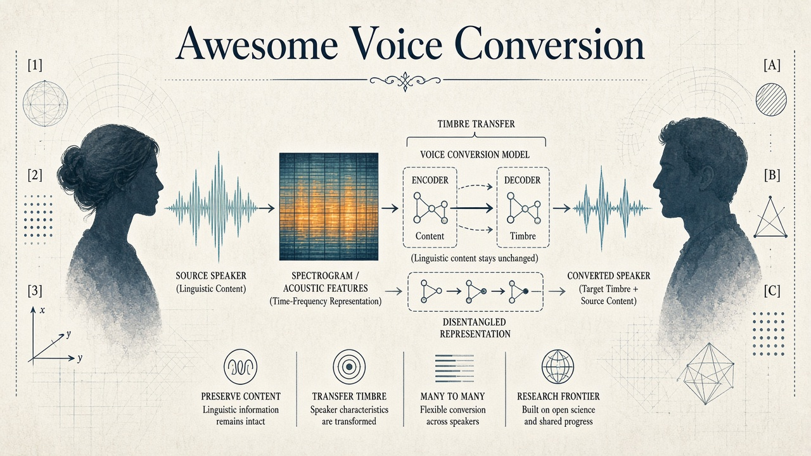

# Awesome Voice Conversion

A curated list of voice conversion and singing voice conversion papers and code. Entries are sorted by release date, newest first.

  

---

Open [Start here](#start-here) if you want a model you can run. The later sections are the full index, grouped by task. A paper appears in only one of those sections.

## Contents

- [Start here](#start-here)
- [Voice conversion](#voice-conversion)
  - [Streaming and real-time](#streaming-and-real-time)
  - [Zero-shot and any-to-any](#zero-shot-and-any-to-any)
  - [Diffusion and flow](#diffusion-and-flow)
  - [GAN](#gan)
  - [Disentanglement](#disentanglement)
  - [Recognition-synthesis](#recognition-synthesis)
  - [Emotion, accent, and cross-lingual](#emotion-accent-and-cross-lingual)
  - [Challenges and classic methods](#challenges-and-classic-methods)
  - [Collected without a link](#collected-without-a-link)
- [Singing voice conversion](#singing-voice-conversion)
- [Datasets and challenges](#datasets-and-challenges)
- [Music and other papers](#music-and-other-papers)
- [Contact](#contact)

## Start here

Systems below are the ones most people clone first. Task-specific papers are in the sections after this table.

| System | Zero-shot | Streaming | Singing | Paper | Code |
| :--- | :---: | :---: | :---: | :--- | :--- |
| MeanVC 2 | ✅ | ✅ | ❌ | [Paper](https://arxiv.org/pdf/2606.09050) | [Code](https://github.com/ASLP-lab/MeanVC2) |
| X-VC | ✅ | ✅ | ❌ | [Paper](https://arxiv.org/pdf/2604.12456) | [Code](https://github.com/Jerrister/X-VC) |
| StyleStream | ✅ | ✅ | ❌ | [Paper](https://arxiv.org/pdf/2602.20113) | [Code](https://github.com/Berkeley-Speech-Group/StyleStream) |
| Stream-Voice-Anon | ✅ | ✅ | ❌ | [Paper](https://arxiv.org/pdf/2601.13948) | [Code](https://github.com/Plachtaa/StreamVoiceAnon) |
| YingMusic-SVC | ✅ | ❌ | ✅ | [Paper](https://arxiv.org/pdf/2512.04793) | [Code](https://github.com/GiantAILab/YingMusic-SVC) |
| Vevo | ✅ | ❌ | ❌ | [Paper](https://arxiv.org/pdf/2502.07243) | [Code](https://github.com/open-mmlab/Amphion/tree/main/models/vc/vevo) |
| MeanVC | ✅ | ✅ | ❌ | [Paper](https://arxiv.org/pdf/2510.08392) | [Code](https://github.com/ASLP-lab/MeanVC) |
| Seed-VC | ✅ | ✅ | ✅ | [Paper](https://arxiv.org/pdf/2411.09943) | [Code](https://github.com/Plachtaa/seed-vc) |
| CosyVoice | ✅ | ✅ | ❌ | [Paper](https://arxiv.org/pdf/2407.05407) | [Code](https://github.com/FunAudioLLM/CosyVoice) |
| OpenVoice | ✅ | ❌ | ❌ | [Paper](https://arxiv.org/pdf/2312.01479) | [Code](https://github.com/myshell-ai/OpenVoice) |
| kNN-VC | ✅ | ❌ | ❌ | [Paper](https://arxiv.org/pdf/2305.18975.pdf) | [Code](https://github.com/bshall/knn-vc) |
| FreeVC | ✅ | ❌ | ❌ | [Paper](https://arxiv.org/abs/2210.15418) | [Code](https://github.com/OlaWod/FreeVC) |
| RVC | ❌ | ✅ | ✅ | | [Code](https://github.com/RVC-Project/Retrieval-based-Voice-Conversion-WebUI) |
| GPT-SoVITS | ✅ | ❌ | ❌ | | [Code](https://github.com/RVC-Boss/GPT-SoVITS) |
| so-vits-svc | ❌ | ❌ | ✅ | | [Code](https://github.com/svc-develop-team/so-vits-svc) |

## Voice conversion

### Streaming and real-time

| Year | System | Paper | Code |
| --- | --- | --- | --- |
| 2026 | MeanVC 2 | [Robust low-latency streaming zero-shot VC](https://arxiv.org/pdf/2606.09050) | [Code](https://github.com/ASLP-lab/MeanVC2) |
| 2026 | X-VC | [Zero-shot streaming VC in codec space](https://arxiv.org/pdf/2604.12456) | [Code](https://github.com/Jerrister/X-VC) |
| 2026 | StyleStream | [Real-time zero-shot voice style conversion](https://arxiv.org/pdf/2602.20113) | [Code](https://github.com/Berkeley-Speech-Group/StyleStream) |
| 2026 | Stream-Voice-Anon | [Real-time speaker anonymization and VC](https://arxiv.org/pdf/2601.13948) | [Code](https://github.com/Plachtaa/StreamVoiceAnon) |
| 2025 | MeanVC | [Lightweight streaming zero-shot VC via mean flows](https://arxiv.org/pdf/2510.08392) | [Code](https://github.com/ASLP-lab/MeanVC) |
| 2024 | StreamVC | [Real-time low-latency voice conversion](https://arxiv.org/abs/2401.03078) | [Code](https://github.com/hrnoh24/stream-vc) · [Code](https://github.com/yuval-reshef/StreamVC) |
| 2023 | LLVC | [Low-latency real-time voice conversion on CPU](https://koe.ai/papers/llvc.pdf) | [Code](https://github.com/KoeAI/LLVC) |
| 2020 | FastVC | [Fast voice conversion with non-parallel data](https://arxiv.org/abs/2010.04185) | |
| 2020 | ConVoice | [Real-time zero-shot voice style transfer](https://www.dropbox.com/s/h781sva0dv177ot/ConVoice.pdf?dl=0) | |
| | Yukarin | Realtime voice conversion application | [Code](https://github.com/Hiroshiba/realtime-yukarin) |

### Zero-shot and any-to-any

| Year | System | Paper | Code |
| --- | --- | --- | --- |
| 2025 | GenVC | [Self-supervised zero-shot voice conversion](https://arxiv.org/pdf/2502.04519) | [Code](https://github.com/caizexin/GenVC) |
| 2025 | Vevo | [Controllable zero-shot voice imitation](https://arxiv.org/pdf/2502.07243) | [Code](https://github.com/open-mmlab/Amphion/tree/main/models/vc/vevo) |
| 2025 | AdaptVC | [High quality VC with adaptive learning](https://arxiv.org/pdf/2501.01347) | [Code](https://github.com/kaistmm/AdaptVC) |
| 2024 | Seed-VC | [Zero-shot VC with diffusion transformers](https://arxiv.org/pdf/2411.09943) | [Code](https://github.com/Plachtaa/seed-vc) |
| 2024 | CosyVoice | [Multilingual zero-shot TTS and voice cloning](https://arxiv.org/pdf/2407.05407) | [Code](https://github.com/FunAudioLLM/CosyVoice) |
| 2023 | OpenVoice | [Versatile instant voice cloning](https://arxiv.org/pdf/2312.01479) | [Code](https://github.com/myshell-ai/OpenVoice) |
| 2023 | Phoneme Hallucinator | [One-shot VC via set expansion](https://arxiv.org/abs/2308.06382) | [Code](https://github.com/PhonemeHallucinator/Phoneme_Hallucinator) |
| 2023 | kNN-VC | [Voice conversion with just nearest neighbors](https://arxiv.org/pdf/2305.18975.pdf) | [Code](https://github.com/bshall/knn-vc) |
| 2023 | TriAAN-VC | [Triple adaptive attention normalization for any-to-any VC](https://arxiv.org/abs/2303.09057) | [Code](https://github.com/winddori2002/TriAAN-VC) |
| 2023 | StyleTTS-VC | [One-shot VC by transfer from style-based TTS](https://arxiv.org/abs/2212.14227) | [Code](https://github.com/yl4579/StyleTTS-VC) |
| 2022 | FreeVC | [Text-free one-shot voice conversion](https://arxiv.org/abs/2210.15418) | [Code](https://github.com/OlaWod/FreeVC) |
| 2022 | DeID-VC | [Speaker de-identification via zero-shot pseudo VC](https://arxiv.org/abs/2209.04530) | [Code](https://github.com/a43992899/DeID-VC) |
| 2022 | LVC-VC | [Zero-shot VC with location-variable convolutions](https://arxiv.org/abs/2205.09784) | [Code](https://github.com/wonjune-kang/lvc-vc) |
| 2021 | Expressive Neural Voice Cloning | [Expressive neural voice cloning](https://www.arxiv-vanity.com/papers/2102.00151/) | |
| 2020 | FragmentVC | [Any-to-any VC by fusing fine-grained voice fragments](https://arxiv.org/abs/2010.14150) | [Code](https://github.com/yistLin/FragmentVC) |
| 2019 | AutoVC | [Zero-shot voice style transfer with only autoencoder loss](https://arxiv.org/pdf/1905.05879.pdf) | [Code](https://github.com/auspicious3000/autovc) · [f0-autovc](https://github.com/hrnoh/f0-autovc) · [pytorch](https://github.com/peisuke/AutoVC.pytorch) · [v2](https://github.com/casperwang/autovc_v2) · [WavRNN](https://github.com/freenowill/AutoVC-WavRNN) · [CODEJIN](https://github.com/CODEJIN/AutoVC) |

### Diffusion and flow

| Year | System | Paper | Code |
| --- | --- | --- | --- |
| 2023 | DDDM-VC | [Decoupled denoising diffusion models for VC](https://arxiv.org/pdf/2305.15816) | [Code](https://github.com/hayeong0/DDDM-VC) |
| 2023 | Diff-HierVC | [Diffusion-based hierarchical VC](https://arxiv.org/abs/2311.04693) | [Code](https://github.com/hayeong0/Diff-HierVC) |
| 2021 | DiffVC | [Diffusion-based VC with fast maximum likelihood sampling](https://arxiv.org/pdf/2109.13821.pdf) | [Code](https://github.com/huawei-noah/Speech-Backbones/tree/main/DiffVC) |
| 2019 | Blow | [Single-scale hyperconditioned flow for non-parallel VC](https://www.dropbox.com/s/6bovin589qr78l8/Blow.pdf?dl=0) | |

### GAN

| Year | System | Paper | Code |
| --- | --- | --- | --- |
| 2022 | NVC-Net | [End-to-end adversarial voice conversion](https://arxiv.org/abs/2106.00992) | [Code](https://github.com/sony/ai-research-code/tree/master/nvcnet) |
| 2022 | SGAN-VC | [Subband GAN for non-parallel many-to-many VC](https://arxiv.org/pdf/2207.06057.pdf) | [Demo](https://hechang25.github.io/SGAN-VC/) |
| 2020 | CVC | [Contrastive learning for non-parallel VC](https://arxiv.org/abs/2011.00782) | [Code](https://github.com/Tinglok/CVC) |
| 2019 | StarGAN-VC2 | [Rethinking conditional methods for StarGAN VC](https://arxiv.org/abs/1907.12279) | [Demo](http://www.kecl.ntt.co.jp/people/kaneko.takuhiro/projects/stargan-vc2/index.html) |
| 2019 | CycleGAN-VC2 | [Improved CycleGAN-based non-parallel VC](https://arxiv.org/abs/1904.04631) | [Demo](http://www.kecl.ntt.co.jp/people/kaneko.takuhiro/projects/cyclegan-vc2/index.html) · [Code](https://github.com/jackaduma/CycleGAN-VC2) |
| 2018 | StarGAN-VC | [Non-parallel many-to-many VC with StarGAN](https://arxiv.org/abs/1806.02169) | [Demo](https://www.kecl.ntt.co.jp/people/kameoka.hirokazu/Demos/stargan-vc/) |
| 2018 | Audio Style Transfer | [Audio style transfer](https://hal.archives-ouvertes.fr/hal-01626389/document) | [Code](https://github.com/inzva/Audio-Style-Transfer) · [Demo](https://egrinstein.github.io/2017/10/25/ast.html) |
| 2018 | CycleGAN-VC | [Parallel-data-free VC with cycle-consistent adversarial networks](https://arxiv.org/abs/1711.11293) | [Demo](http://www.kecl.ntt.co.jp/people/kaneko.takuhiro/projects/cyclegan-vc/index.html) |
| 2017 | VAW-GAN | [VC from unaligned corpora with VAE and WGAN](https://arxiv.org/abs/1704.00849) | [Demo](https://jeremycchsu.github.io/vc-vawgan/) |
| 2015 | RandomCNN voice transfer | [A neural algorithm of artistic style](https://arxiv.org/abs/1508.06576) | [Code](https://github.com/mazzzystar/randomCNN-voice-transfer) |

### Disentanglement

| Year | System | Paper | Code |
| --- | --- | --- | --- |
| 2021 | Multi-factor VC | [Adversarially learning disentangled speech representations](https://arxiv.org/pdf/2102.00184.pdf) | |
| 2020 | SpeechSplit | [Unsupervised speech decomposition via triple information bottleneck](https://arxiv.org/abs/2004.11284) | [Demo](https://auspicious3000.github.io/SpeechSplit-Demo/) |
| 2020 | CDVAE-VC | [Disentanglement with cross-domain features in a VAE](https://ieeexplore.ieee.org/abstract/document/9057379) | [Code](https://github.com/unilight/cdvae-vc) |
| 2020 | Any-to-one S3R VC | [Any-to-one seq2seq VC with self-supervised discrete units](https://arxiv.org/pdf/2010.12231.pdf) | |
| 2020 | CycleVAE + PWG | [VCC 2020 baseline with cyclic VAE and Parallel WaveGAN](https://arxiv.org/abs/2010.04429) | |
| 2019 | ACVAE-VC | [Many-to-many VC with an auxiliary classifier VAE](https://arxiv.org/abs/1808.05092) | [Demo](http://www.kecl.ntt.co.jp/people/kameoka.hirokazu/Demos/acvae-vc/) |
| 2019 | Non-parallel seq2seq VC | [Disentangled linguistic and speaker representations](https://arxiv.org/pdf/1906.10508.pdf) | [Code](https://github.com/jxzhanggg/nonparaSeq2seqVC_code) |
| 2018 | Disentangled multi-target VC | [Multi-target VC by adversarially learning disentangled audio](https://arxiv.org/pdf/1804.02812.pdf) | [Code](https://github.com/BogiHsu/Voice-Conversion) |
| 2020 | ZeroSpeech VQ-VAE | Acoustic unit discovery and voice conversion | [Code](https://github.com/bshall/ZeroSpeech) |

### Recognition-synthesis

ASR, TTS, or phonetic-posteriorgram pipelines.

| Year | System | Paper | Code |
| --- | --- | --- | --- |
| 2022 | HiFi-VC | [High quality ASR-based voice conversion](https://arxiv.org/abs/2203.16937) | [Code](https://github.com/tinkoff-ai/hifi_vc) |
| 2022 | Hybrid bottleneck VC | [Content and fine-grained prosody via hybrid ASR features](https://arxiv.org/pdf/2203.12813.pdf) | [Demo](https://thuhcsi.github.io/icassp2022-hybrid-bottleneck-vc/) |
| 2021 | PPG-VC | [Any-to-many VC with location-relative seq2seq modeling](https://arxiv.org/abs/2009.02725v3) | [Code](https://github.com/liusongxiang/ppg-vc) |
| 2020 | VCC 2020 ASR+TTS | [Cascading ASR and TTS](https://arxiv.org/abs/2010.02434) | [Code](https://github.com/espnet/espnet) |
| 2020 | TTS-to-VC transfer | [Transfer learning from speech synthesis to VC](https://arxiv.org/abs/2009.14399) | |
| 2020 | Adversarial many-to-many VC | [Speaker identity via adversarial speaker recognition](https://www.interspeech2020.org/uploadfile/pdf/Mon-2-7-2.pdf) | [Code](https://github.com/shaojinding/Adversarial-Many-to-Many-VC) |
| 2016 | PPG many-to-one VC | [Phonetic posteriorgrams for many-to-one VC](https://ieeexplore.ieee.org/document/7552917) | [Code](https://github.com/andabi/deep-voice-conversion) |

### Emotion, accent, and cross-lingual

| Year | System | Paper | Code |
| --- | --- | --- | --- |
| 2024 | MulliVC | [Multi-lingual VC with cycle consistency](https://arxiv.org/pdf/2408.04708) | |
| 2024 | DurFlex-EVC | [Duration-flexible emotional voice conversion](https://arxiv.org/pdf/2401.08095v1.pdf) | [Code](https://github.com/hs-oh-prml/durflexevc) |
| 2024 | Voice transfer for TTS | [Zero-shot cross-lingual voice transfer for TTS](https://arxiv.org/pdf/2409.13910) | |
| 2023 | Beta-VAE VC | [One-shot cross-lingual VC with a beta-VAE](https://www1.se.cuhk.edu.hk/~hccl/publications/pub/2023%20SLT2022-Beta_VAE_based_one_shot_cross_lingual_VC.pdf) | [Code](https://github.com/light1726/BetaVAE_VC) |
| 2022 | Speak Like a Dog | [Human to non-human creature voice conversion](https://arxiv.org/abs/2206.04780) | |
| 2021 | Cross-lingual PPG VC | [Cross-lingual VC with neural TTS and PPG](https://www.arxiv-vanity.com/papers/2102.01991/) | |
| 2020 | Emotional style transfer | [Seen and unseen emotional style transfer](https://arxiv.org/pdf/2010.14794.pdf) | [Demo](https://kunzhou9646.github.io/controllable-evc/) |
| 2020 | Accent and speaker | [Accent and speaker disentanglement in many-to-many VC](https://arxiv.org/pdf/2011.08609.pdf) | [Demo](https://kerwinchao.github.io/AccentVoicejointConversion.github.io/) |
| 2020 | TransferLearning-CLVC | [Monolingual ASR to transcription-free cross-lingual VC](https://arxiv.org/ftp/arxiv/papers/2009/2009.14668.pdf) | [Code](https://github.com/cjerry1243/TransferLearning-CLVC) |
| 2019 | Segmental accent conversion | [PPG frame pairing for segmental accent conversion](https://ieeexplore.ieee.org/document/8755490) | |

### Challenges and classic methods

| Year | System | Paper | Code |
| --- | --- | --- | --- |
| 2020 | VC survey | [From statistical modeling to deep learning](https://arxiv.org/pdf/2008.03648.pdf) | |
| 2020 | Academia Sinica VCC 2020 | [The Academia Sinica systems for VCC 2020](https://arxiv.org/abs/2010.02669) | |
| 2020 | NU VCC 2020 | [Seq2seq models and autoregressive neural vocoders](https://arxiv.org/abs/2010.04446) | |
| 2018 | VCC 2018 | [Promoting parallel and nonparallel methods](https://arxiv.org/abs/1804.04262) | [Dataset](https://datashare.ed.ac.uk/handle/10283/3061) |
| 2018 | sprocket | [Open-source voice conversion software](https://nuss.nagoya-u.ac.jp/s/h8YKnq6qxjjxtU3#pdfviewer) | [Code](https://github.com/k2kobayashi/sprocket) · [Paper](https://nuss.nagoya-u.ac.jp/s/h8YKnq6qxjjxtU3) · [Samples](https://nuss.nagoya-u.ac.jp/login) |
| 2016 | F0 transformation | [F0 transformation for statistical VC](https://ieeexplore.ieee.org/document/7846338) | [Code](https://github.com/k2kobayashi/sprocket) |
| 2015 | BLSTM VC | [VC with deep bidirectional LSTM](https://ieeexplore.ieee.org/document/7178896) | |
| 2007 | GMM VC | [Maximum likelihood spectral trajectory](https://ieeexplore.ieee.org/document/4317579?reload=true) | |

### Collected without a link

These were in the old method notes and never had a paper or code URL.

- **AGAIN-VC** (2020). One-shot voice conversion with activation guidance and adaptive instance normalization.
- **Crank**. Non-parallel VC with a vector-quantized VAE and adversarial learning. Kobayashi, Huang, and Toda.
- **VQ-VAE speech**. VQ-VAE + WaveNet (Chorowski et al., 2019) and VQ-VAE on speech (van den Oord et al., 2017).
- **HVQ-VAE**. Cross-lingual VC with a hierarchical vector-quantized VAE. Ho and Akagi, VCC 2020.
- **CycleVAE**. Cyclic VAE voice conversion with Parallel WaveGAN for VCC 2020. The linked baseline is in [Disentanglement](#disentanglement).
- **Unaligned-data VC**. Comparison of a standard VAE, VQ-VAE, and Gumbel VAE on VCC 2016.
- **ZeroSpeech 2019**. Unsupervised discrete linguistic units for voice conversion ("TTS without T").
- **MelGAN-VC**. Voice conversion and audio style transfer on long spectrograms.
- **Cotatron**. Transcription-guided speech encoder for any-to-many VC without parallel data. Park, Kim, and Joe.
- **WaveNet autoencoders** (ZeroSpeech 2020). Instance normalization (IN-WAE) and sliced vector quantization (SVQ-WAE).
- **Adversarial WaveNet VC** (2019). WaveNet autoencoders with one decoder per voice and adversarial domain adaptation.

## Singing voice conversion

| Year | System | Paper | Code |
| --- | --- | --- | --- |
| 2025 | YingMusic-SVC | [Robust zero-shot singing VC with Flow-GRPO](https://arxiv.org/pdf/2512.04793) | [Code](https://github.com/GiantAILab/YingMusic-SVC) |
| 2025 | HQ-SVC | [High-quality zero-shot SVC in low-resource settings](https://arxiv.org/pdf/2511.08496) | [Code](https://github.com/ShawnPi233/HQ-SVC) |
| 2025 | FreeSVC | [Zero-shot multilingual singing voice conversion](https://arxiv.org/pdf/2501.05586) | [Code](https://github.com/freds0/free-svc) |
| 2021 | Hierarchical SVC | [Hierarchical disentangled representation learning for SVC](https://arxiv.org/pdf/2101.06842.pdf) | |
| 2021 | Lyrics and style transfer | [End-to-end lyrics recognition with voice-to-singing transfer](https://arxiv.org/pdf/2102.08575.pdf) | |
| 2021 | Anyone GAN Sing | [Anyone GAN Sing](https://arxiv.org/pdf/2102.11058.pdf) | |
| 2021 | MLP Singer | [Rapid parallel Korean singing voice synthesis](https://arxiv.org/pdf/2106.07886.pdf) | [Code](https://github.com/CODEJIN/MLPSinger) |
| 2020 | EA-SVC | [PPG-based many-to-many SVC via adversarial training](https://arxiv.org/pdf/2012.01837.pdf) | [Code](https://github.com/hhguo/EA-SVC) · [Paper](https://arxiv.org/abs/2012.01837) |
| 2020 | PPG SVC | [PPG-based singing VC with adversarial representation learning](https://arxiv.org/pdf/2010.14804.pdf) | |
| 2020 | VAW-GAN SVC | [VAW-GAN for SVC with non-parallel data](https://arxiv.org/pdf/2008.03992.pdf) | [Code](https://github.com/KunZhou9646/Singing-Voice-Conversion-with-conditional-VAW-GAN) |
| 2020 | Speech-to-singing | [Speech-to-singing conversion with BEGAN](https://arxiv.org/pdf/2005.13835.pdf) | [Code](https://github.com/ericwudayi/speech2singing) |
| 2018 | Universal music translation | [A universal music translation network](https://arxiv.org/abs/1805.07848) | [Code](https://github.com/facebookresearch/music-translation) |
| | so-vits-svc | SoftVC VITS singing voice conversion | [Code](https://github.com/svc-develop-team/so-vits-svc) |
| | SingingVoiceConversion | | [Code](https://github.com/jshong0907/SingingVoiceConversion) |
| | Singing-Voice-Conversion | | [Code](https://github.com/solalala-12/Singing-Voice-Conversion) |

## Datasets and challenges

| Name | What it is | Link |
| --- | --- | --- |
| Voice Conversion Challenge | Challenge home | [Home](http://www.vc-challenge.org/) |
| ZeroSpeech | 2020 challenge news | [Home](https://zerospeech.com/2020/news.html) |
| VCTK | Multi-speaker English speech | [Download](https://datashare.is.ed.ac.uk/handle/10283/3443) |
| ZeroSpeech 2020 | Challenge data | [Download](https://download.zerospeech.com/) |
| VCC 2016 | Voice Conversion Challenge 2016 | [Download](https://datashare.is.ed.ac.uk/handle/10283/2211) |
| VCC 2018 | Voice Conversion Challenge 2018 | [Download](https://datashare.is.ed.ac.uk/handle/10283/3061) · [Mirror](https://datashare.ed.ac.uk/handle/10283/3061) |

The VCC 2018 overview paper is in [Challenges and classic methods](#challenges-and-classic-methods).

## Music and other papers

### Music

| Year | System | Paper | Code |
| --- | --- | --- | --- |
| 2024 | Latent diffusion bridges | [Unsupervised musical audio timbre transfer](https://arxiv.org/abs/2409.06096) | [Code](https://github.com/sony/diffusion-timbre-transfer) |
| 2021 | Self-supervised VQ-VAE | [One-shot music style transfer](https://arxiv.org/abs/2102.05749) | [Code](https://github.com/cifkao/ss-vq-vae) |
| 2021 | PeriodNet | [Periodic and aperiodic waveform generation](https://arxiv.org/pdf/2102.07786) | |
| 2020 | HiFiSinger | [High-fidelity neural singing voice synthesis](https://arxiv.org/pdf/2009.01776) | |
| 2020 | ByteSing | [Chinese singing voice synthesis](https://arxiv.org/pdf/2004.11012) | |
| 2020 | Jukebox | [A generative model for music](https://arxiv.org/pdf/2005.00341) | |
| 2020 | Parallel WaveGAN | [Fast waveform generation with a multi-resolution spectrogram GAN](https://arxiv.org/pdf/1910.11480.pdf) | |
| 2017 | Onsets and Frames | [Dual-objective piano transcription](https://arxiv.org/abs/1710.11153) | |
| 2016 | WORLD | [Vocoder-based speech synthesis for real-time use](https://www.jstage.jst.go.jp/article/transinf/E99.D/7/E99.D_2015EDP7457/_article) | [Code](http://www.kki.yamanashi.ac.jp/~mmorise/world/english/index.html) |

### Other

| Year | System | Paper |
| --- | --- | --- |
| 2020 | Attention norms | [Attention is not only a weight: analyzing Transformers with vector norms](https://arxiv.org/pdf/2004.10102) |
| 2019 | FlowSeq | [Non-autoregressive conditional sequence generation with generative flow](https://arxiv.org/pdf/1909.02480) |
| 2019 | PASE | [Problem-agnostic speech representations from multiple self-supervised tasks](https://arxiv.org/pdf/1904.03416.pdf) |
| 2019 | Mobile audio SSL | [Self-supervised audio representation learning for mobile devices](https://arxiv.org/pdf/1905.11796.pdf) |
| 2019 | SinGAN | [Learning a generative model from a single natural image](http://openaccess.thecvf.com/content_ICCV_2019/papers/Shaham_SinGAN_Learning_a_Generative_Model_From_a_Single_Natural_Image_ICCV_2019_paper.pdf) |
| 2019 | Audio2Face | [Speech and face animation from a single audio](https://arxiv.org/pdf/1905.11142) |
| 2017 | RevNet | [The reversible residual network](https://arxiv.org/pdf/1707.04585) |

## Contact

Questions and additions are welcome.
